# VehicleChain — Semana 3: Functional Proof

## 1. Front construido

**Enlace al front:** <https://vehiclechain-frontend.bolt.host/>

El front de VehicleChain es una aplicación web en **React + Vite + TypeScript** (estilos con Tailwind e íconos Lucide) que permite recorrer de punta a punta el flujo del MVP definido en el Product Blueprint: un administrador habilita talleres, el propietario registra su vehículo, el taller registra servicios y recibe evidencia de publicación, y el propietario consulta el historial, controla quién accede a él y transfiere su titularidad dentro de la plataforma.

En esta etapa todos los datos son **simulados en memoria** (`src/data/mockData.ts`): no hay backend, base de datos ni contrato Soroban conectados. Las pantallas que muestran hashes o transacciones de Stellar lo indican explícitamente, porque la integración real corresponde a la siguiente etapa (ver §2).

### Estructura y navegación

La aplicación arranca en una **pantalla de selección de rol**, que reemplaza la autenticación durante la demo. Al elegir un rol se abre su panel, compuesto por un layout común (`AppLayout`):

- **Barra lateral** con el menú del rol, contadores (por ejemplo, talleres pendientes o posibles duplicados) y la opción **Cambiar de rol**, que devuelve a la pantalla inicial sin recargar.
- **Barra superior** con buscador y el usuario activo.
- **Área de contenido**, donde se renderiza la pantalla seleccionada.

La navegación se resuelve con estado de React (`role` y `activePage` en `App.tsx`), no con rutas de URL. Cada rol tiene un **dashboard** con tarjetas de acceso directo a sus pantallas, de modo que el flujo puede recorrerse desde el menú o desde el dashboard. Como los datos simulados son compartidos entre roles, lo que hace un rol se refleja en otro durante la misma sesión: por ejemplo, la solicitud que envía el taller aparece en la lista del administrador, y el servicio registrado por el taller entra al historial del vehículo.

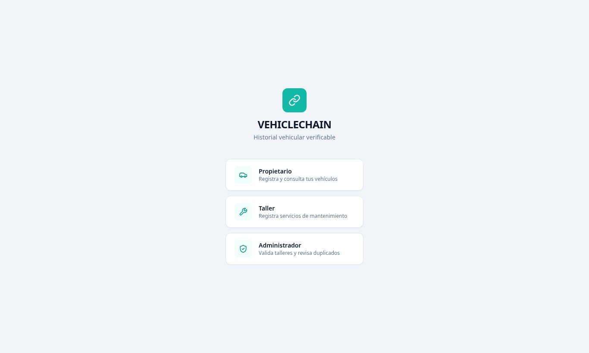

### Mapa de pantallas e historias

| Rol | Pantalla | Historia | Qué demuestra |
| --- | --- | --- | --- |
| Todos | Selección de rol | — | Acceso simulado a los tres roles del MVP |
| Propietario | Dashboard | — | Resumen de vehículos y actividad reciente |
| Propietario | Registrar Vehículo | `HU1JP(1)` | Alta del vehículo al que se asocian los servicios |
| Propietario | Mis Vehículos → detalle | `HU2JP(2)` | Historial cronológico de mantenimientos por vehículo |
| Propietario | Permisos a Talleres | `HU3JP(3)` | Control de qué taller accede a qué vehículo |
| Propietario | Transferencias | `HU4JP(4)` | Transferencia de la titularidad del historial |
| Taller | Dashboard | — | Estado del taller y servicios registrados |
| Taller | Registrar Taller | `HU1JT(1)` | Solicitud de incorporación, queda pendiente de validación |
| Taller | Registrar Servicio | `HU2JT(2)` | Registro del mantenimiento sobre un vehículo existente |
| Taller | Publicación del mantenimiento | `HU3JT(3)` | Evidencia de publicación (red, transacción, hash) |
| Administrador | Dashboard | — | Talleres pendientes y posibles duplicados |
| Administrador | Validar Talleres | `HU1JA(1)` | Aprobar o rechazar solicitudes de talleres |
| Administrador | Detectar Duplicados | `HU6JA(2)` | Alertas de servicios potencialmente repetidos |

Las nueve historias del MVP tienen al menos una pantalla asociada; ninguna pantalla queda aislada del flujo.

### Rol Propietario

El **dashboard** saluda al propietario y resume sus vehículos y su actividad reciente, con accesos a las demás pantallas.

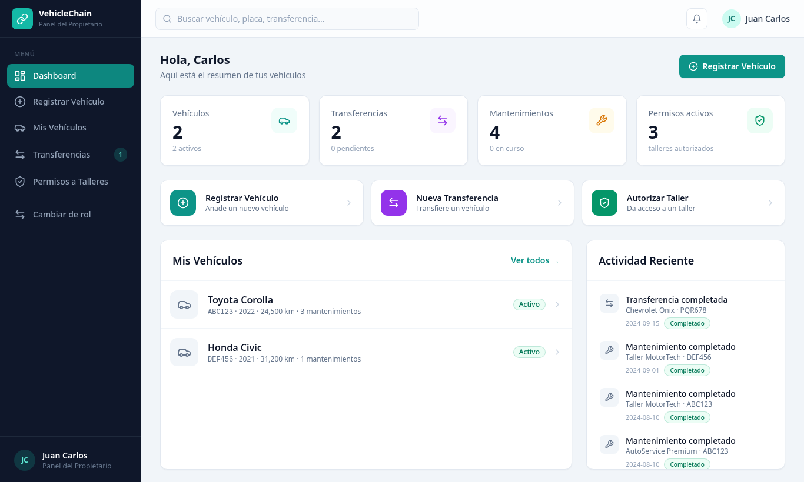

**Registrar Vehículo — `HU1JP(1)`.** Formulario con placa, VIN, marca, modelo, año, color, kilometraje y tipo de combustible. Todos los campos son obligatorios. Al enviarlo, el vehículo queda asociado al propietario y disponible para que un taller registre servicios sobre él.

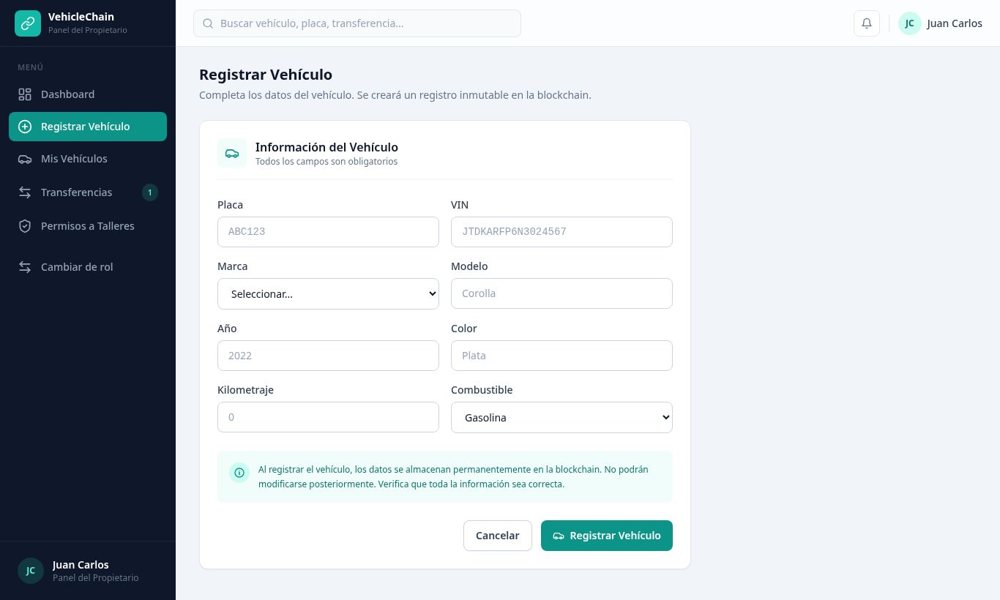

**Mis Vehículos e historial — `HU2JP(2)`.** Lista los vehículos del propietario con buscador por placa o modelo. Al seleccionar uno se abre su ficha (año, color, combustible, kilometraje, VIN, fecha de registro) y el **Historial de Mantenimientos** en línea de tiempo: cada servicio muestra fecha, taller que lo realizó, descripción, kilometraje y estado. Esta es la pantalla que mejor comunica la propuesta de valor del Blueprint: un historial **continuo y asociado al vehículo**, aunque lo alimenten talleres distintos (en el ejemplo, Taller MotorTech y AutoService Premium sobre el mismo Toyota Corolla).

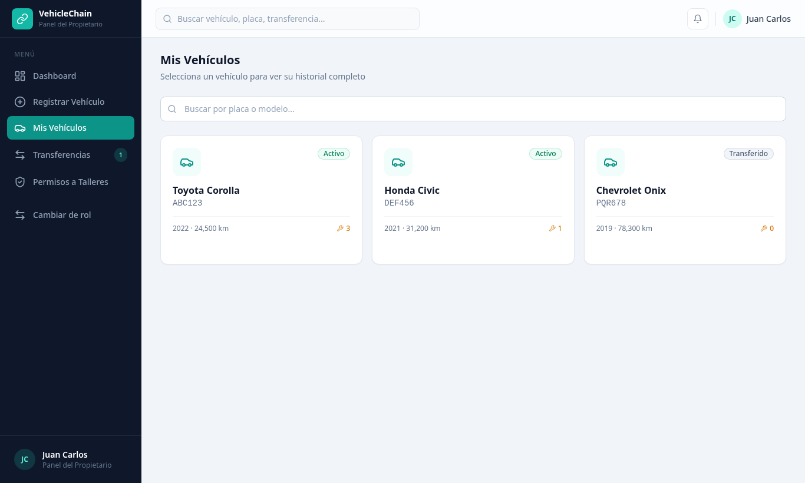

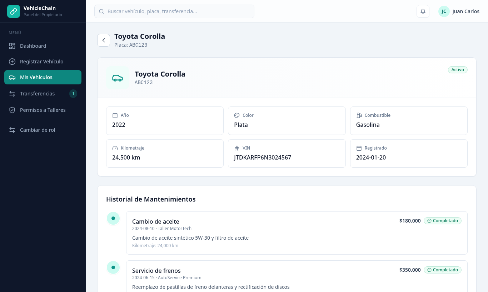

**Permisos a Talleres — `HU3JP(3)`.** Muestra los permisos activos y revocados por vehículo y taller, y permite **otorgar** un permiso nuevo indicando vehículo, correo del taller, alcance (solo mantenimiento, solo diagnóstico o acceso completo) y fecha de expiración, o **revocar** uno existente. Responde al criterio de aceptación de que el propietario decide quién consulta su historial; en la arquitectura del Blueprint estos permisos viven off-chain.

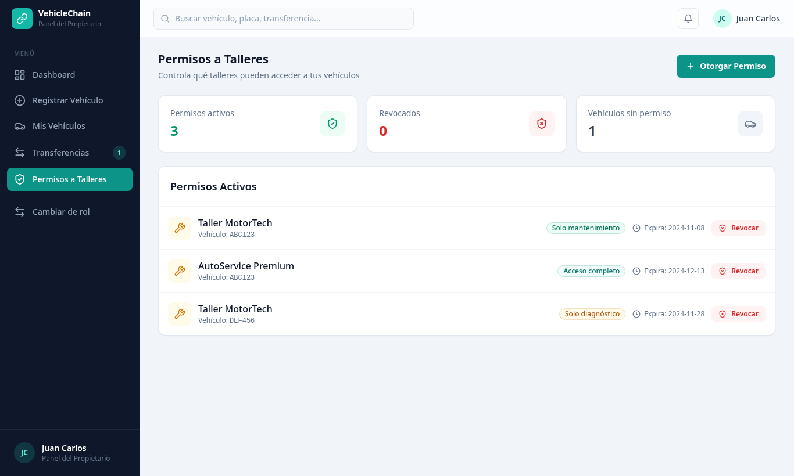

**Transferencias — `HU4JP(4)`.** Lista las transferencias del historial (completadas, pendientes y rechazadas) con propietario anterior, nuevo propietario, fecha y hash de evidencia, y permite iniciar una **nueva transferencia**. La operación representa la **transferencia de la titularidad del historial dentro de VehicleChain**: el nuevo propietario recibe el mismo historial sin que se modifiquen los servicios anteriores. No sustituye el traspaso jurídico del vehículo, que sigue realizándose por los mecanismos oficiales.

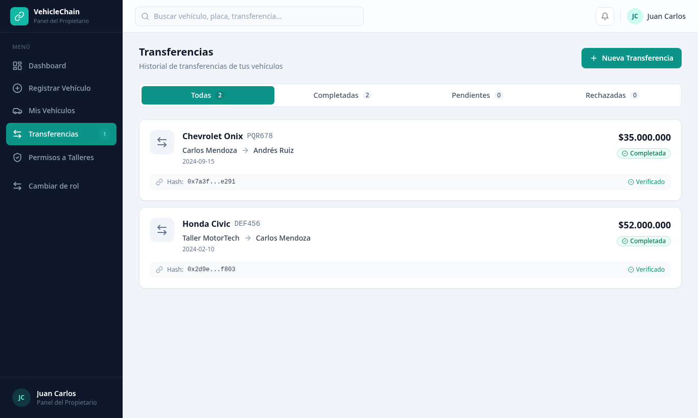

### Rol Taller

El **dashboard del taller** muestra el número de servicios registrados, el estado del taller (pendiente de validación) y accesos a sus dos acciones principales, además de la lista de últimos servicios registrados.

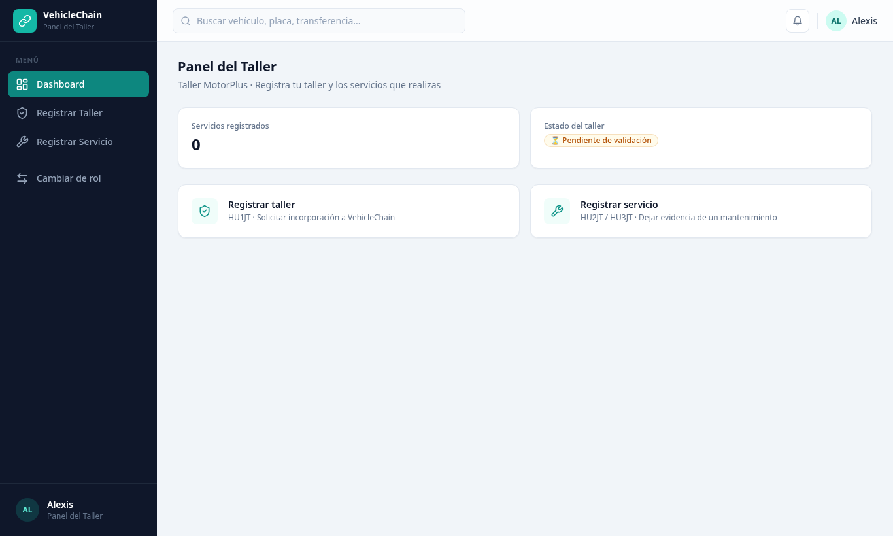

**Registrar Taller — `HU1JT(1)`.** Formulario de solicitud de incorporación con nombre, NIT, dirección, ciudad, correo y teléfono. Al enviarlo, la solicitud queda en estado **⏳ Pendiente de validación** y aparece en el panel del administrador. Así se materializa la regla del Blueprint de que solo talleres habilitados participan.

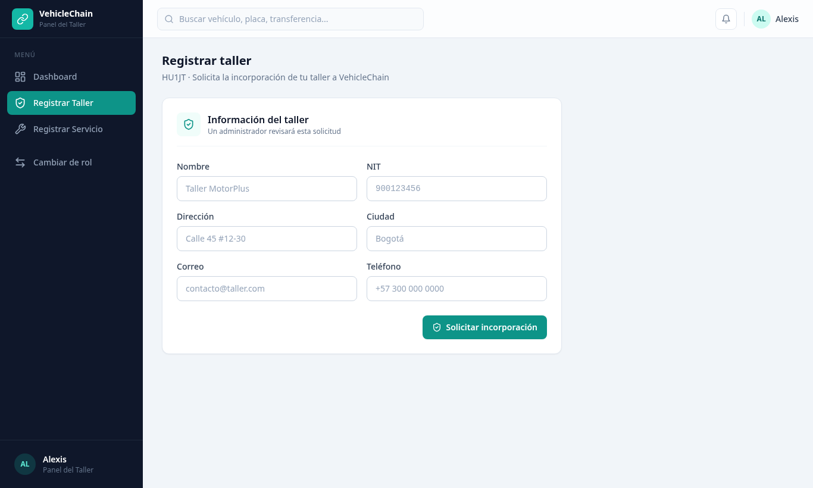

**Registrar Servicio — `HU2JT(2)`.** El taller indica la placa de un vehículo ya registrado, el tipo de servicio (cambio de aceite, frenos, rotación de neumáticos, inspección, reparación u otro), descripción, fecha y kilometraje. Si la placa no corresponde a un vehículo existente, el registro no se realiza. El servicio aceptado se agrega al historial del vehículo, lo que conecta esta pantalla con la consulta del propietario.

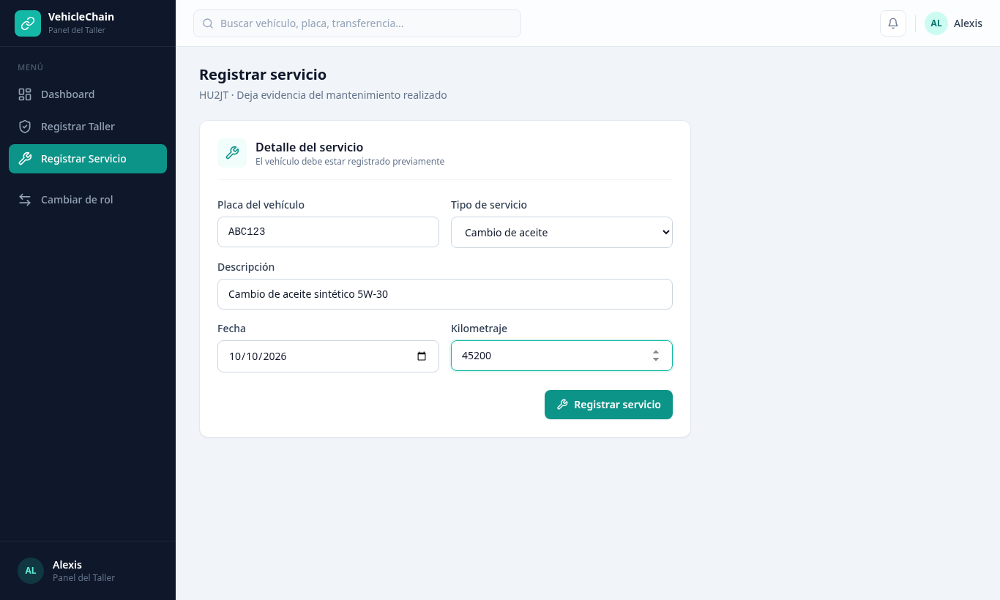

**Publicación del mantenimiento — `HU3JT(3)`.** Tras registrar el servicio, la interfaz muestra un estado intermedio "Publicando evidencia…" y luego la tarjeta de **Publicación del mantenimiento** con estado ✓ Publicado, red (Stellar Testnet), identificador de transacción y hash. La pantalla aclara que son **datos simulados** y que la integración real con Soroban corresponde a la siguiente etapa. Su objetivo es dejar listo el punto exacto donde el contrato devolverá la referencia verificable al taller.

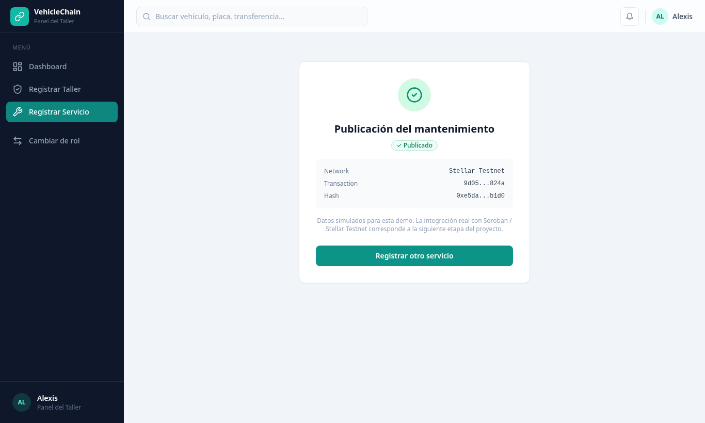

### Rol Administrador

El **dashboard del administrador** muestra dos indicadores: talleres pendientes de validación y grupos de posibles duplicados, con accesos a cada pantalla.


**Validar Talleres — `HU1JA(1)`.** Lista las solicitudes pendientes con nombre, NIT y ciudad, y botones **Aprobar** y **Rechazar**. Al decidir, la solicitud pasa a la sección "Ya revisadas" con su estado. En el contrato propio (§2), esta decisión es la que habilitará al taller para publicar evidencia.

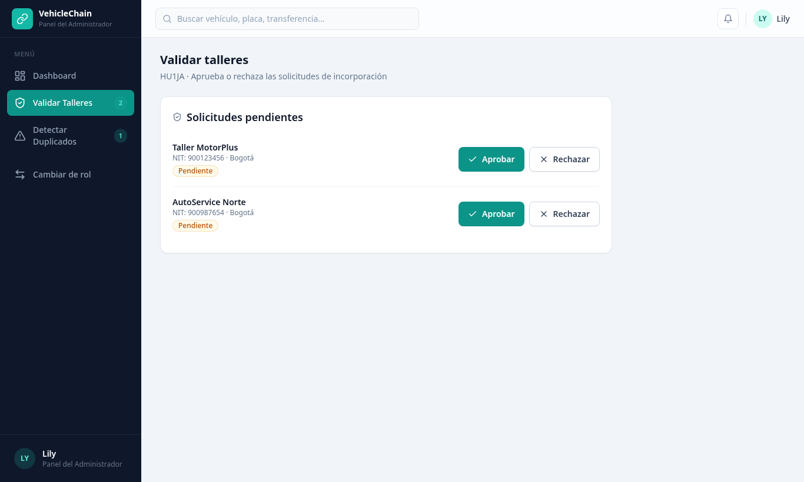

**Detectar Duplicados — `HU6JA(2)`.** Agrupa servicios con el mismo vehículo, tipo y fecha registrados por talleres distintos, y los presenta como **Posible registro duplicado** con las opciones Revisar o Continuar. El sistema no elimina registros automáticamente, tal como exige el criterio de aceptación. Es una regla de demostración; la versión definitiva comparará también kilometraje y se ejecutará en el backend.

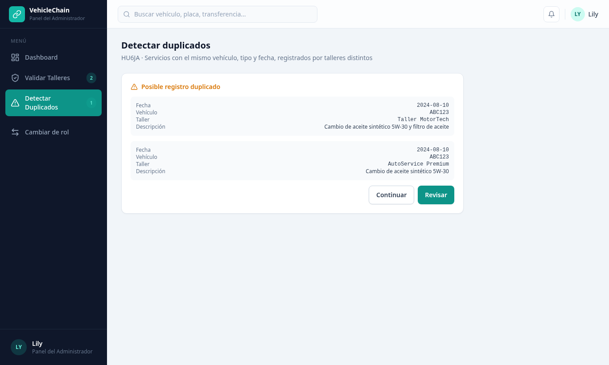

### Relación con el MVP del Blueprint

El front recorre la misma secuencia definida en el Blueprint (§3 y §10):

```text
Taller validado → Vehículo registrado → Servicio registrado → Duplicados detectados
→ Evidencia publicada → Historial consultable → Permisos → Transferencia de titularidad del historial
```

Se respetaron los límites del MVP: no existe rol comprador, no hay consulta al RUNT ni traspaso jurídico, y no se muestran datos personales como parte de la evidencia en Stellar. Lo que queda simulado (autenticación, persistencia y publicación en Soroban) corresponde a las capas de backend, PostgreSQL y contrato que se implementarán en la siguiente etapa; el front ya tiene identificados los puntos donde se conectarán: registro de taller y vehículo, publicación de evidencia del servicio y transferencia de la titularidad del historial.

---

## 2. Decisión técnica

### Opción elegida: A — Contrato propio en Soroban

VehicleChain creará su propio contrato Soroban, desplegado inicialmente en **Stellar Testnet**. Esta semana solo se documenta la decisión; el contrato se implementará en la siguiente etapa.

### Qué hará el contrato

El Blueprint define que Stellar no se usa para el CRUD de vehículos, talleres y servicios (eso lo resuelve PostgreSQL), sino como **capa de evidencia compartida para operaciones críticas**. El contrato registrará y ejecutará únicamente lo siguiente:

| Función | Qué registra o ejecuta en la red | Historia |
| --- | --- | --- |
| Registrar taller autorizado | Identificador del taller y su estado (habilitado / rechazado), firmado por el administrador | `HU1JA(1)`, `HU1JT(1)` |
| Registrar vehículo | Identificador técnico del vehículo y la `Address` del propietario actual del historial | `HU1JP(1)` |
| Publicar evidencia de servicio | Identificador del vehículo, del servicio y del taller, hash del registro off-chain y timestamp | `HU2JT(2)`, `HU3JT(3)` |
| Consultar evidencia | Lectura del hash publicado para comprobar que el registro en PostgreSQL no fue modificado | `HU2JP(2)` |
| Transferir titularidad del historial | Actualización de la `Address` del propietario y evento de transferencia, sin alterar los servicios previos | `HU4JP(4)` |

Las operaciones protegidas usarán `Address` y `require_auth`: solo un taller habilitado puede publicar evidencia y solo el propietario actual puede transferir el historial. No se almacenan en el ledger datos personales, documentos ni órdenes de trabajo completas; permisos de consulta (`HU3JP(3)`) y detección de duplicados (`HU6JA(2)`) permanecen en el backend.

### Por qué hace falta un contrato propio

La propuesta de valor del Blueprint es **integridad + trazabilidad + autorización de operaciones críticas**. Las reglas que la sostienen son específicas del dominio: qué talleres pueden publicar, a qué vehículo pertenece cada evidencia, quién es el titular actual del historial y que una transferencia nunca modifique los registros anteriores. Ninguna herramienta genérica del ecosistema impone estas reglas por nosotros; un contrato propio las hace verificables por cualquier participante sin depender de la base de datos de una sola organización, que es precisamente la decisión técnica central del Blueprint.

### Qué se descartó (Opción B)

- **Escribir el hash en el campo memo o en `manageData` de una transacción Stellar clásica:** permite anclar evidencia, pero no valida quién publica ni gestiona la titularidad del historial; toda la autorización quedaría en el backend y la cadena solo guardaría datos sin reglas.
- **Tokenizar el vehículo como activo/NFT (p. ej. con contratos estándar de tokens):** modela propiedad transferible y comerciable, lo cual podría confundirse con el traspaso jurídico que el Blueprint excluye explícitamente del MVP.
- **Servicios externos de notarización o anclaje de hashes:** añaden un intermediario y no ofrecen la lógica de talleres habilitados ni la continuidad del historial entre propietarios.

Sí se aprovechará el ecosistema existente como **herramientas de apoyo**, no como sustituto del contrato: Soroban SDK y Stellar CLI para desarrollo y despliegue, Stellar Testnet y Friendbot para pruebas sin activos reales, y Stellar Expert para que la referencia de publicación (`HU3JT(3)`) sea verificable públicamente.

---

## 3. Participación del equipo

> Pendiente: usuario de GitHub, aporte y responsabilidad de cada integrante.

---

## 4. Bloqueos y siguiente paso

> Pendiente.
